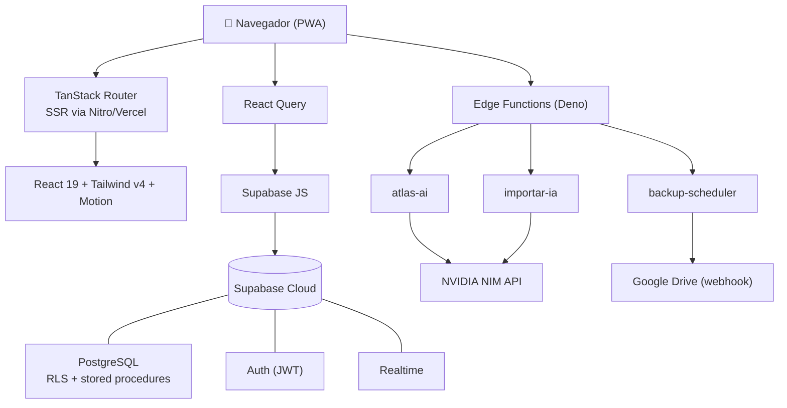

<div align="center">

# 🏕️ GDA Caixa 2027

**O sistema financeiro PWA do Clube de Desbravadores Guerreiros do Alto**

Três caixas independentes, PDV, metas, dívidas, relatórios, transparência pública e um assistente de IA.
Mobile-first, instalável como app e com modo claro e escuro.


[Funcionalidades](#-funcionalidades) · [Começando](#-começando) · [Arquitetura](#-arquitetura) · [Testes](#-testes) · [Contribuindo](#-contribuindo)

</div>

---

## ✨ Funcionalidades

| | Recurso | O que faz |
|---|---|---|
| 💰 | **Três caixas independentes** | Geral, Doceria e Vendas Rápidas. Transferências internas são contabilizadas sem distorcer o patrimônio consolidado. |
| 🛒 | **PDV (ponto de venda)** | Produtos com ícone, cor e ficha técnica de ingredientes. Ao confirmar, registra a receita e a despesa de custo, para mostrar o lucro real. |
| 🎯 | **Metas financeiras** | Destinação manual ou lucro automático, barra de progresso animada e aportes reversíveis. |
| 🤖 | **Atlas AI** | Chat financeiro com NVIDIA Nemotron 30B. Lê saldos em tempo real, propõe operações e só executa depois da confirmação (tool calling em duas rodadas). |
| 📥 | **Importação inteligente** | Cole texto livre ou um `.txt`. A IA classifica cada linha, gera uma prévia editável com totais, destaca itens de baixa confiança e detecta duplicatas. O lote pode ser desfeito. |
| 🧾 | **Controle de dívidas** | Pagamento parcial com barra de progresso e agendamento de exclusão automática. |
| 📊 | **Relatórios e exportação** | Balancete oficial para impressão, CSV, backup em JSON e Google Drive via Apps Script. |
| 🔍 | **Transparência pública** | Rota `/transparencia` sem login, para pais e para a comissão da igreja. |
| 🔐 | **RBAC com 5 papéis** | `admin`, `diretor`, `tesoureiro`, `conselheiro` e `desbravador`. O RLS no banco reforça as permissões. |

---

## 🧰 Stack

| Camada | Tecnologia |
|---|---|
| Framework | TanStack Start 1.168 + TanStack Router 1.170 |
| UI | React 19, Tailwind CSS v4, tokens customizados do Material Design 3 |
| Animações | Motion (`motion/react`) v14 |
| Backend e banco | Supabase (PostgreSQL, Auth, RLS, Realtime, Edge Functions) |
| IA | NVIDIA NIM API, modelo `nvidia/nemotron-3.5-lightning-30b-a3b` |
| Deploy | Vercel (adaptador Nitro) |
| Testes | Vitest + Testing Library |
| ORM e migrations | Drizzle Kit (`drizzle/migrations/`) |
| Componentes | Radix UI + shadcn/ui + Recharts + Vaul (drawers) |

---

## 🚀 Começando

### Pré-requisitos

- [Node.js](https://nodejs.org) 20 ou superior
- [Bun](https://bun.sh) como gerenciador de pacotes
- Um projeto no [Supabase](https://supabase.com)
- Uma chave da NVIDIA NIM API

### Instalação

```bash
git clone https://github.com/Porozin/bright-wallet-atlas
cd bright-wallet-atlas
bun install
```

### Variáveis de ambiente

Crie o arquivo `.env` na raiz:

```env
VITE_SUPABASE_URL=https://<projeto>.supabase.co
VITE_SUPABASE_PUBLISHABLE_KEY=sb_publishable_...
VITE_SUPABASE_PROJECT_ID=<projeto>
```

<details>
<summary><b>Todas as variáveis</b></summary>

| Variável | Onde configurar | Descrição |
|---|---|---|
| `VITE_SUPABASE_URL` | `.env` | URL do projeto Supabase |
| `VITE_SUPABASE_PUBLISHABLE_KEY` | `.env` | Chave anon/publishable |
| `VITE_SUPABASE_PROJECT_ID` | `.env` | ID do projeto |
| `NVIDIA_API_KEY` | Supabase Secrets | Chave da NVIDIA NIM |
| `SUPABASE_SERVICE_ROLE_KEY` | Supabase Secrets | Service role usada pelas edge functions |

</details>

> [!WARNING]
> Nunca coloque `SUPABASE_SERVICE_ROLE_KEY` ou `NVIDIA_API_KEY` no `.env` versionado. Elas ficam só nos **Supabase Secrets**.

### Banco de dados

Aplique os arquivos de `drizzle/migrations/` em ordem numérica, pelo **Supabase Dashboard → SQL Editor**.

### Rodando

```bash
bun run dev      # desenvolvimento
bun run build    # produção (Vercel/Nitro)
```

---

## 🏗️ Arquitetura



### Regras financeiras inegociáveis

> [!IMPORTANT]
> Toda a lógica financeira vive em `src/lib/finance.ts`, como funções puras. Os componentes nunca calculam saldos: eles consomem `summarizeBox` e `consolidateAllBoxes`.

- Cálculos internos em **centavos inteiros** (evita erros de ponto flutuante IEEE 754)
- Transferências internas **não** somam receita nem despesa no consolidado
- Só `status = confirmar` entra no saldo oficial
- Reservas comprometem o saldo disponível, sem remover o saldo contábil
- Estorno gera uma transação compensatória e **nunca** apaga a original

### Estrutura do projeto

<details>
<summary><b>Ver árvore de pastas</b></summary>

```text
src/
├── routes/
│   ├── __root.tsx                 # Shell HTML, viewport meta, script de tema
│   ├── _authenticated/
│   │   ├── index.tsx              # Dashboard consolidado
│   │   ├── clube.tsx              # Caixa Geral + Metas + Almoxarifado
│   │   ├── doceria.tsx            # Caixa Doceria + PDV + Insumos
│   │   ├── vendas.tsx             # Caixa Vendas + PDV + Avarias
│   │   └── mais.tsx               # Perfil, relatórios, importação, admin
│   └── transparencia.tsx          # Página pública de transparência
├── components/m3/                 # Primitivos Material Design 3
│   ├── AppShell.tsx               # Layout + modo escuro + Atlas AI
│   ├── PdvGrid.tsx                # Ponto de venda interativo
│   ├── AtlasAiDrawer.tsx          # Chat com o assistente de IA
│   ├── ImportarDrawer.tsx         # Importação inteligente via IA
│   ├── ResponsiveTransactionList.tsx
│   └── MetaProgressBar.tsx
├── lib/
│   ├── finance.ts                 # Regras financeiras puras
│   ├── data.ts                    # Hooks React Query + Supabase
│   └── printReport.ts             # Gerador de PDF
└── hooks/
    ├── useTheme.ts                # Modo claro/escuro (useSyncExternalStore)
    ├── useHaptic.ts               # Feedback háptico
    └── useImportarIA.ts           # Cliente da edge function

supabase/functions/
├── atlas-ai/                      # Assistente financeiro (NVIDIA NIM)
├── importar-ia/                   # Extração de texto via IA
└── backup-scheduler/              # Backup automático no Google Drive

drizzle/migrations/                # Migrations numeradas (0000 a 0015)
```

</details>

---

## 🧪 Testes

```bash
bun run test            # Vitest em modo watch
bun run test --run      # Execução única (CI)
```

| Arquivo | Cobertura |
|---|---|
| `finance.test.ts` | `toCents`, `summarize`, `consolidateAllBoxes`, margens |
| `fase1b.test.ts` | RPCs oficiais, idempotência, transferências |
| `fase2.test.ts` | Consolidação multi-caixa, reservas |
| `fase5.test.ts` | Relatórios e exportação |
| `MetaDrawer.test.tsx` | Formulário de metas (criar/editar) |
| `updateMeta.test.ts` | `aportarMeta`, status de conclusão |
| `wipe.test.ts` | Limpeza total do sistema |

---

## 📐 Padrões de código

- Funções financeiras puras em `src/lib/finance.ts`, sem imports de React e sem efeitos colaterais
- Componentes em `src/components/m3/` usam apenas tokens Tailwind, sem valores fixos
- Edge Functions em Deno TypeScript, com autenticação obrigatória via JWT
- Mutations passam por stored procedures (`sp_registrar_transacao_oficial` e similares), para garantir idempotência e auditoria
- Novas colunas: crie `drizzle/migrations/NNNN_descricao.sql` e aplique pelo Supabase Dashboard

---

## 🤝 Contribuindo

1. Crie uma branch a partir de `main`.
2. **Nova tela:** adicione em `src/routes/_authenticated/` e atualize o tipo union em `BottomNav.tsx`.
3. **Nova lógica financeira:** função pura em `finance.ts`, com teste em `finance.test.ts`.
4. **Novo componente M3:** use os tokens existentes, sem cores fixas.

---

## 📄 Licença

Projeto privado do Clube de Desbravadores Guerreiros do Alto.
Uso restrito à organização. Não licenciado para redistribuição.
