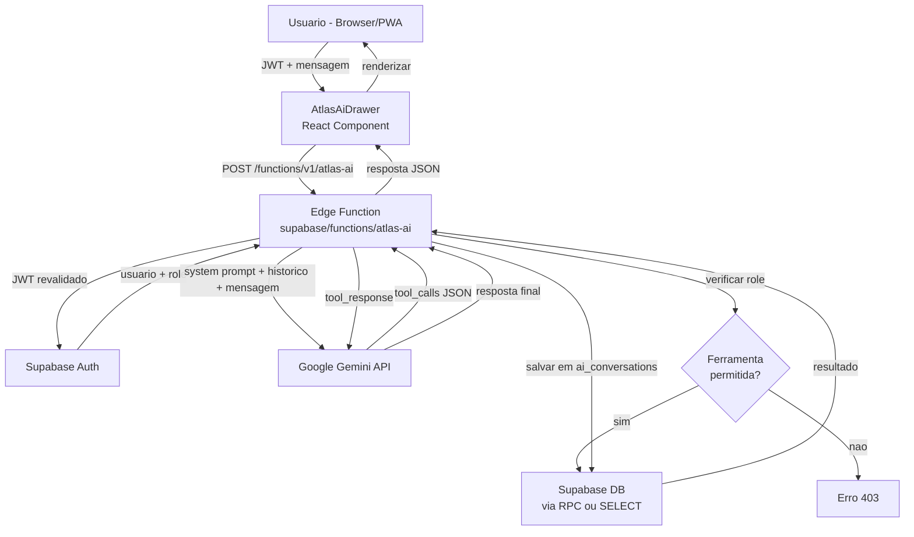
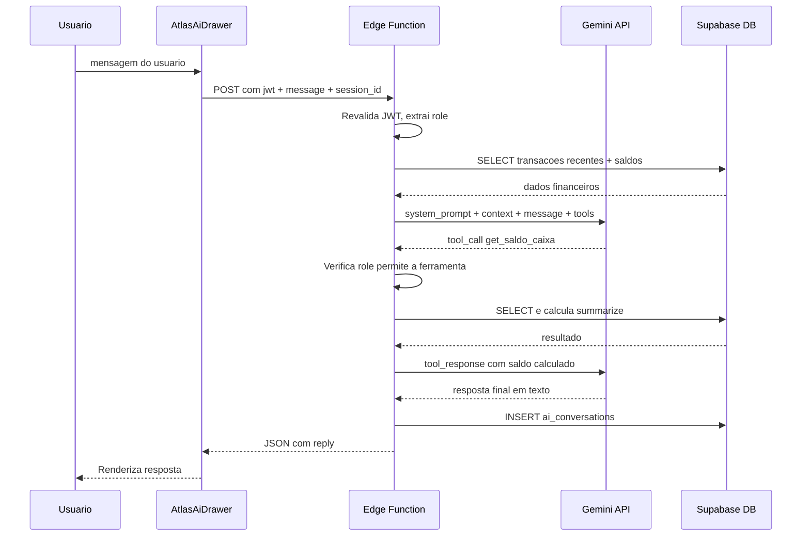
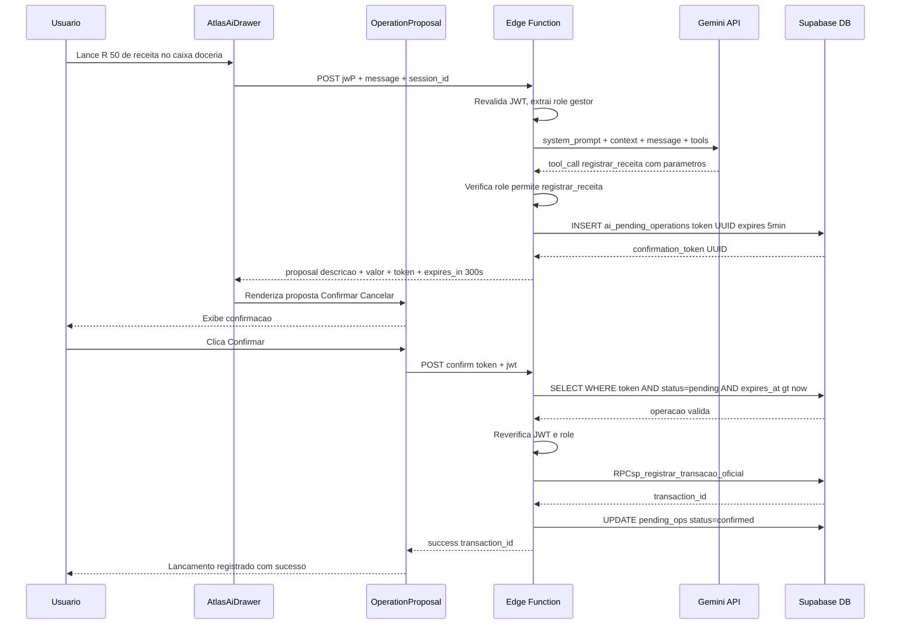

# Arquitetura do Atlas AI

> Especificacao tecnica da integracao de IA conversacional ao GDACaixa.

---

## 1. Visao Geral

O Atlas AI e uma camada conversacional que permite aos usuarios interagir com o sistema financeiro em linguagem natural. A arquitetura segue o principio de que o frontend nunca executa operacoes financeiras diretamente: toda escrita passa pela Edge Function, que valida permissoes antes de chamar as RPCs existentes.



---

## 2. Componentes Principais

### 2.1 AtlasAiDrawer (src/components/m3/AtlasAiDrawer.tsx)

Componente React que renderiza a interface de chat dentro do AppShell. Responsabilidades:

- Exibir o historico de mensagens da sessao atual
- Capturar input do usuario e enviar ao hook useAtlasAi
- Renderizar propostas de operacao de escrita via OperationProposal
- Exibir estado de carregamento e erros
- Nao contem logica de negocio nem chama RPCs diretamente

Integracao com AppShell: botao flutuante (FAB) ou item dedicado na BottomNav abre o drawer como sheet sobreposto.

### 2.2 Edge Function (supabase/functions/atlas-ai/index.ts)

Orquestradora central do fluxo de IA. Responsabilidades:

- Receber POST com `{ message, session_id, jwt }`
- Revalidar o JWT via Supabase Admin client
- Extrair o role do usuario de user_roles
- Buscar contexto financeiro (saldo, ultimas transacoes)
- Montar system prompt com contexto + restricoes do role
- Chamar Gemini com function calling habilitado
- Executar tool calls autorizados
- Persistir mensagens em ai_conversations
- Retornar resposta final ao frontend

### 2.3 atlasTools.ts (src/lib/atlasTools.ts)

Definicao tipada (TypeScript) de todas as ferramentas que o AI pode chamar. Este arquivo e compartilhado entre frontend e Edge Function (via import ou copia). Contem:

- Tipos de parametros para cada ferramenta
- Schema JSON para envio ao Gemini
- Tipos de retorno
- Mapeamento ferramenta -> RPC subjacente

### 2.4 Tabela ai_conversations

Historico persistente de mensagens. Schema (migration 0010):

```sql
CREATE TABLE ai_conversations (
  id          uuid PRIMARY KEY DEFAULT gen_random_uuid(),
  user_id     uuid NOT NULL REFERENCES auth.users(id) ON DELETE CASCADE,
  session_id  uuid NOT NULL,
  role        text NOT NULL CHECK (role IN ('user', 'assistant', 'tool')),
  content     text NOT NULL,
  tool_calls  jsonb,
  created_at  timestamptz NOT NULL DEFAULT now()
);

CREATE INDEX idx_ai_conversations_session ON ai_conversations(session_id, created_at);
CREATE INDEX idx_ai_conversations_user ON ai_conversations(user_id, created_at);

-- RLS: usuario ve apenas suas proprias mensagens
ALTER TABLE ai_conversations ENABLE ROW LEVEL SECURITY;
CREATE POLICY "own_conversations" ON ai_conversations
  FOR ALL USING (user_id = auth.uid());
```

---

## 3. Fluxo de uma Operacao de Leitura



---

## 4. Fluxo de uma Operacao de Escrita com Confirmacao



---

## 5. Gerenciamento de Contexto

O que e enviado ao Gemini em cada requisicao:

**System prompt (~500 tokens) :**
- Instrucoes de comportamento e restricoes do Atlas AI
- Role do usuario (ex: voce esta atendendo um tesoureiro)
- Data e hora atuais
- Resumo financeiro: saldo de cada caixa, total de receitas/despesas do mes, numero de solicitacoes pendentes
- Ultimas 5 mensagens da sessao atual (de ai_conversations)

**Mensagem do usuario (~50-200 tokens):**
- Texto atual enviado

**Ferramentas disponieis:**
- Lista filtrada pelo role do usuario (conselheiro nao ve ferramentas de escrita gestores)

**Estrategia para controlar tamanho do contexto:**
- Usar summarize() para resumir saldos, nao enviar lista completa de transacoes
- Buscar detalhes de transacoes apenas quando o AI chamar get_transacoes_recentes
- Limitar historico a ultimas 5 mensagens no contexto
- Cache de saldo com TTL de 60 segundos antes de enviar ao Gemini

## 6. Tool Calling

### Ferramentas de Leitura

| Nome | Parametros | Retorno | Permissao |
|---|---|---|---|
| get_saldo_consolidado | nenhum | {boxes, total_balance, total_income, total_expenses} | conselheiro+ |
| get_saldo_caixa | cash_box_id: string | {id, name, balance, income, expenses} | conselheiro+ |
| get_transacoes_recentes | cash_box_id?, limit? max 50, date_from?, date_to? | Transaction[] | conselheiro+ |
| get_metas | modulo?: string | Meta[] com progresso | conselheiro+ |
| get_resumo_mensal | ano: number, mes?: number | jsonb de sp_resumo_transparencia_publica | conselheiro+ |
| get_produtos | modulo?: string | Produto[] | conselheiro+ |
| get_ranking_vendedores | nenhum | [{seller, total_sales, commission}] | conselheiro+ |
| get_dividas | nenhum | Divida[] | conselheiro+ |

### Ferramentas de Escrita - Gestores

| Nome | Parametros | RPC | Confirmacao |
|---|---|---|---|
| registrar_receita | cash_box_id, amount_cents, category, description, payment_method, date, seller? | sp_registrar_transacao_oficial kind=income | Sim |
| registrar_despesa | cash_box_id, amount_cents, category, description, payment_method, date | sp_registrar_transacao_oficial kind=expense | Sim |
| registrar_transferencia | source_box, destination_box, amount_cents, description, date? | sp_registrar_transferencia | Sim |
| estornar_transacao | transaction_id, reverse_reason | sp_estornar_transacao | Sim |
| criar_reserva | cash_box_id, title, amount_cents, description? | sp_criar_reserva | Sim |
| liberar_reserva | reservation_id | sp_liberar_reserva | Sim |

### Ferramentas de Escrita - Conselheiros

| Nome | Parametros | RPC | Confirmacao |
|---|---|---|---|
| solicitar_despesa | cash_box_id, amount_cents, category, description, date, payment_method | sp_solicitar_despesa | Sim |

---

## 7. Sistema de Confirmacao

Quando o AI chama uma ferramenta de escrita, a Edge Function nao executa a RPC imediatamente. Em vez disso:

1. Gera um UUID v4 como confirmation_token
2. Registra a operacao em ai_pending_operations com operation_type, params (jsonb), confirmation_token, expires_at = now() + 5 minutos, status = pending
3. Retorna ao frontend: proposal com operation_type, params, token, expires_in: 300

O frontend renderiza o OperationProposal com detalhes e botoes Confirmar / Cancelar.

### Validacoes na Confirmacao

Quando o usuario confirma (POST /functions/v1/atlas-ai/confirm):

1. Revalidar JWT - sessao ainda valida?
2. SELECT ai_pending_operations WHERE token = ? AND status = pending AND expires_at > now() - 404 se nao encontrar
3. Verificar que user_id do registro bate com user_id do JWT
4. Verificar novamente que o role atual ainda permite a operacao
5. Executar RPC com params armazenados no banco (nunca com params do request de confirmacao)
6. UPDATE ai_pending_operations SET status = confirmed
7. Retornar success com transaction_id

### Schema da Tabela ai_pending_operations (migration 0011)

```sql
CREATE TABLE ai_pending_operations (
  id                 uuid PRIMARY KEY DEFAULT gen_random_uuid(),
  user_id            uuid NOT NULL REFERENCES auth.users(id) ON DELETE CASCADE,
  operation_type     text NOT NULL,
  params             jsonb NOT NULL,
  confirmation_token text NOT NULL UNIQUE,
  expires_at         timestamptz NOT NULL,
  status             text NOT NULL DEFAULT pending
                       CHECK (status IN (pending, confirmed, expired, cancelled)),
  created_at         timestamptz NOT NULL DEFAULT now(),
  confirmed_at       timestamptz
);

CREATE INDEX idx_pending_ops_token ON ai_pending_operations(confirmation_token);
CREATE INDEX idx_pending_ops_user   ON ai_pending_operations(user_id, created_at);

ALTER TABLE ai_pending_operations ENABLE ROW LEVEL SECURITY;
CREATE POLICY own_pending_ops ON ai_pending_operations
  FOR ALL USING (user_id = auth.uid());
```

---

## 8. Estrategia de Provedor Intercambiavel

A Edge Function isola a chamada ao modelo por tras de uma interface AIProvider. Para trocar Gemini por outro modelo: implementar a interface e substituir a instancia na Edge Function.

```typescript
// supabase/functions/atlas-ai/providers.ts

export interface AIMessage {
  role: user | assistant | tool;
  content: string;
  tool_calls?: ToolCall[];
  tool_call_id?: string;
}

export interface ToolCall {
  id: string;
  name: string;
  arguments: Record<string, unknown>;
}

export interface AIProvider {
  chat(params: {
    system: string;
    messages: AIMessage[];
    tools: ToolDefinition[];
  }): Promise<{
    content: string;
    tool_calls: ToolCall[];
    usage: { input_tokens: number; output_tokens: number };
  }>;
}

export class GeminiProvider implements AIProvider {
  constructor(private apiKey: string, private model = gemini-2.0-flash) {}
  async chat(params) { /* chamar Gemini API */ }
}
```

---

## 9. Decisoes Tecnicas e Justificativas

| Decisao | Alternativa considerada | Justificativa |
|---|---|---|
| Edge Function como orquestradora | Chamar Gemini direto do frontend | Nunca expor service_role ou API key ao browser |
| Token de confirmacao para escritas | Executar diretamente ao receber tool_call | Sem confirmacao, o AI poderia lancar transacoes por acidente |
| Params armazenados no banco nao no frontend | Frontend envia params na confirmacao | Impede manipulacao dos parametros entre proposta e execucao |
| Filtrar ferramentas por role antes de enviar ao Gemini | Deixar o modelo decidir | O modelo nao deve nem receber definicao de ferramentas que nao pode usar |
| Historico de chat no banco ai_conversations | Manter no frontend localStorage | Persistencia entre sessoes e dispositivos; auditavel |
| Cache de saldo com TTL 60s | Sem cache | Reduz chamadas ao banco e tokens de contexto sem sacrificar precisao relevante |
| Gemini 2.0 Flash como modelo padrao | Gemini 1.5 Pro | Menor custo e latencia com suporte a function calling adequado ao uso |
