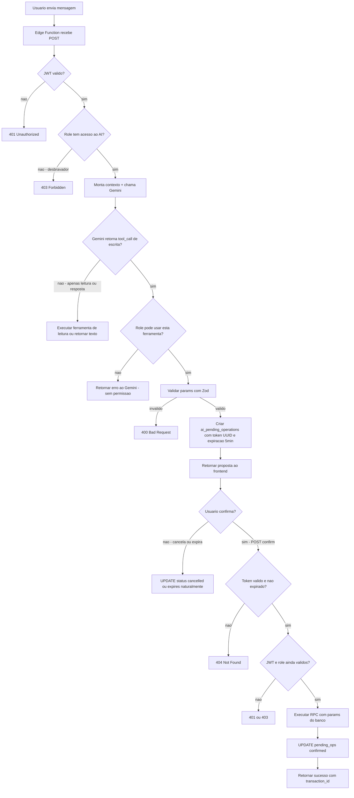

# Modelo de Seguranca - Atlas AI

> Especificacao de seguranca para a integracao do Atlas AI ao GDACaixa. Deve ser lida e validada antes de qualquer deploy em producao.

---

## 1. Principios Fundamentais

1. **A service_role key nunca vai ao frontend.** Ela existe apenas como Supabase Secret na Edge Function. Qualquer codigo client-side usa apenas a publishable key.
2. **O AI opera exclusivamente por ferramentas autorizadas.** Sem SQL arbitrario, sem acesso direto a tabelas, sem execucao de codigo nao auditado.
3. **Toda escrita requer confirmacao explicita do usuario humano.** O AI pode propor, nunca executar diretamente.
4. **As RPCs existentes sao a unica fonte de verdade para permissoes de escrita.** A Edge Function verifica o role, mas a RPC verificara novamente no PostgreSQL.
5. **Dados consultados sao dados, nao instrucoes.** Descricoes de transacoes, nomes de categorias e qualquer conteudo do banco sao tratados como dados nao confiaveis.
6. **Principio do menor privilegio.** Cada role ve apenas as ferramentas que pode usar. Conselheiros nao recebem nem a definicao das ferramentas de gestores.

---

## 2. Fluxo de Autenticacao

O usuario ja esta autenticado no frontend via Supabase Auth (JWT de 7 dias). Ao enviar uma mensagem ao Atlas AI:

1. Frontend obtem o JWT atual via supabase.auth.getSession()
2. JWT e enviado no header Authorization: Bearer <jwt> da requisicao para a Edge Function
3. Edge Function instancia um cliente Supabase com o JWT do usuario: createClient(SUPABASE_URL, SUPABASE_PUBLISHABLE_KEY, { global: { headers: { Authorization: bearer_jwt } } })
4. Edge Function chama supabase.auth.getUser() para revalidar o JWT diretamente com o Supabase Auth server
5. Se getUser() retornar erro: Edge Function responde 401 Unauthorized imediatamente
6. Se valido: extrair user.id e user.app_metadata ou consultar user_roles para obter o role

Note: nunca confiar no payload do JWT decodificado sem revalidacao. O JWT pode estar malformado ou ter sido revogado.

---

## 3. Verificacao de Permissoes por Ferramenta

Antes de executar qualquer ferramenta, a Edge Function verifica:

```typescript
// supabase/functions/atlas-ai/permissions.ts

type Role = admin | diretor | tesoureiro | conselheiro | desbravador;

const TOOL_PERMISSIONS: Record<string, Role[]> = {
  get_saldo_consolidado:    [admin, diretor, tesoureiro, conselheiro],
  get_saldo_caixa:          [admin, diretor, tesoureiro, conselheiro],
  get_transacoes_recentes:  [admin, diretor, tesoureiro, conselheiro],
  get_metas:                [admin, diretor, tesoureiro, conselheiro],
  get_resumo_mensal:        [admin, diretor, tesoureiro, conselheiro],
  get_produtos:             [admin, diretor, tesoureiro, conselheiro],
  get_ranking_vendedores:   [admin, diretor, tesoureiro, conselheiro],
  get_dividas:              [admin, diretor, tesoureiro, conselheiro],
  solicitar_despesa:        [admin, diretor, tesoureiro, conselheiro],
  registrar_receita:        [admin, diretor, tesoureiro],
  registrar_despesa:        [admin, diretor, tesoureiro],
  registrar_transferencia:  [admin, diretor, tesoureiro],
  estornar_transacao:       [admin, diretor, tesoureiro],
  criar_reserva:            [admin, diretor, tesoureiro],
  liberar_reserva:          [admin, diretor, tesoureiro],
};

export function canUseTool(role: Role, toolName: string): boolean {
  return TOOL_PERMISSIONS[toolName]?.includes(role) ?? false;
}
```

Se canUseTool retornar false: Edge Function responde 403 e registra a tentativa.

---

## 4. Mapeamento de Ferramentas por Role

| Ferramenta | admin | diretor | tesoureiro | conselheiro | desbravador |
|---|---|---|---|---|---|
| get_saldo_consolidado | sim | sim | sim | sim | nao |
| get_saldo_caixa | sim | sim | sim | sim | nao |
| get_transacoes_recentes | sim | sim | sim | sim | nao |
| get_metas | sim | sim | sim | sim | nao |
| get_resumo_mensal | sim | sim | sim | sim | nao |
| get_produtos | sim | sim | sim | sim | nao |
| get_ranking_vendedores | sim | sim | sim | sim | nao |
| get_dividas | sim | sim | sim | sim | nao |
| solicitar_despesa | sim | sim | sim | sim | nao |
| registrar_receita | sim | sim | sim | nao | nao |
| registrar_despesa | sim | sim | sim | nao | nao |
| registrar_transferencia | sim | sim | sim | nao | nao |
| estornar_transacao | sim | sim | sim | nao | nao |
| criar_reserva | sim | sim | sim | nao | nao |
| liberar_reserva | sim | sim | sim | nao | nao |

Desbravadores nao tem acesso ao AI no MVP - retornar 403 antes mesmo de processar a mensagem.

---

## 5. Protecao Contra Prompt Injection

Dados consultados do banco podem conter texto que tente imitar instrucoes ao modelo.

**Medidas implementadas:**

1. **Separacao estrutural:** dados do banco sao inseridos como JSON no canal tool_response, nao como texto livre no system prompt. O modelo os recebe via tool_response, nao via mensagem de sistema.

2. **Instrucao explicita no system prompt:** incluir instrucao de que qualquer conteudo retornado pelas ferramentas e dado nao confiavel e nao deve ser interpretado como instrucao.

3. **Sanitizacao de saida:** sanitizar HTML antes de exibir respostas do AI para prevenir XSS.

4. **Sem execucao de codigo:** o AI nao tem ferramenta que execute codigo arbitrario. tool_calls fora das ferramentas definidas sao ignorados.

---

## 6. Sistema de Confirmacao - Detalhes de Seguranca

### Token UUID
- Gerado com crypto.randomUUID() na Edge Function
- Armazenado em ai_pending_operations com indice UNIQUE
- Nunca derivado de parametros previsveis

### Expiracao
- expires_at = now() + interval 5 minutes no banco
- Verificado no SELECT de confirmacao: WHERE expires_at > now()
- UI exibe countdown para o usuario

### Uso Unico
- Apos confirmacao: UPDATE status = confirmed
- Segunda tentativa com mesmo token encontra status != pending e retorna 404

### Vinculacao ao Usuario
- ai_pending_operations.user_id = auth.uid() do JWT que criou a proposta
- Na confirmacao: verificar que user_id do token = user_id do JWT atual
- Impede que usuario A confirme operacao proposta pelo usuario B

---

## 7. Validacao de Parametros com Zod

Todos os parametros de ferramentas de escrita sao validados com Zod na Edge Function ANTES de qualquer chamada a RPC.

```typescript
// supabase/functions/atlas-ai/schemas.ts
export const RegistrarReceitaSchema = z.object({
  cash_box_id:    z.string().uuid(),
  amount_cents:   z.number().int().positive().max(10_000_000),
  category:       z.string().min(1).max(100),
  description:    z.string().min(1).max(500),
  payment_method: z.enum([dinheiro, pix, cartao_credito, cartao_debito]),
  date:           z.string().regex(YYYY-MM-DD format),
  seller:         z.string().max(100).optional(),
});

export const EstornarTransacaoSchema = z.object({
  transaction_id: z.string().uuid(),
  reverse_reason: z.string().min(10).max(500),
});
```

Se a validacao Zod falhar: retornar 400 com descricao do campo invalido, sem chamar nenhuma RPC.


---

## 8. Prevencao de Operacoes Duplicadas

As RPCs existentes aceitam client_mutation_id (UUID). A Edge Function gera um UUID unico por execucao e passa como client_mutation_id. Se a requisicao for retentada por instabilidade de rede, a RPC retorna o mesmo resultado sem criar duplicata.

O confirmation_token tambem serve como client_mutation_id, garantindo idempotencia de ponta a ponta.

---

## 9. Auditoria

Toda operacao de escrita executada pelo AI passa por uma das RPCs existentes. Essas RPCs ja registram entradas em transaction_audit_logs automaticamente - sem codigo extra necessario.

O campo tool_calls em ai_conversations registra qual ferramenta foi chamada com quais parametros, permitindo rastrear qualquer acao do AI ate a mensagem que a originou.

---

## 10. O que o AI Nunca Pode Fazer

- SQL arbitrario: nenhuma ferramenta aceita queries SQL como parametro
- sp_wipe_all_data: esta RPC nao e exposta como ferramenta em hipotese alguma
- sp_deletar_transacao_admin: nao exposta (admin apenas, risco alto)
- Modificar seu proprio codigo: sem ferramenta de escrita em arquivos do sistema
- Alterar permissoes de usuarios: sem ferramenta que modifique user_roles
- Acessar a service_role key: existe apenas como Supabase Secret, nao em variavel acessivel ao modelo
- Criar novos usuarios: sem ferramenta que chame supabase.auth.admin.createUser
- Executar escritas sem confirmacao: qualquer escrita exige confirmacao do usuario humano
- Acessar dados de outros usuarios: RLS impede no banco; a Edge Function nao faz queries sem o JWT correto
- Responder a instrucoes embutidas em dados do banco: protegido pela separacao estrutural descrita na secao 5

---

## 11. Tratamento de Confirmacoes Expiradas ou Reutilizadas

| Cenario | Resposta | Mensagem ao Usuario |
|---|---|---|
| Token nao encontrado | 404 | Esta operacao nao existe ou ja foi processada |
| Token expirado | 404 | Esta operacao expirou. Solicite novamente se necessario |
| Token ja confirmado | 404 | Esta operacao ja foi executada |
| Token cancelado | 404 | Esta operacao foi cancelada |
| Token de outro usuario | 404 | Esta operacao nao existe ou ja foi processada |
| JWT expirado | 401 | Sua sessao expirou. Faca login novamente |
| Role mudou entre proposta e confirmacao | 403 | Voce nao tem permissao para executar esta operacao |

Nota: token de outro usuario retorna 404 (nao 403) para nao revelar que o token existe mas pertence a outra pessoa.

---

## 12. Diagrama de Seguranca - Operacao de Escrita


